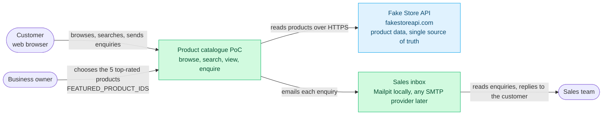
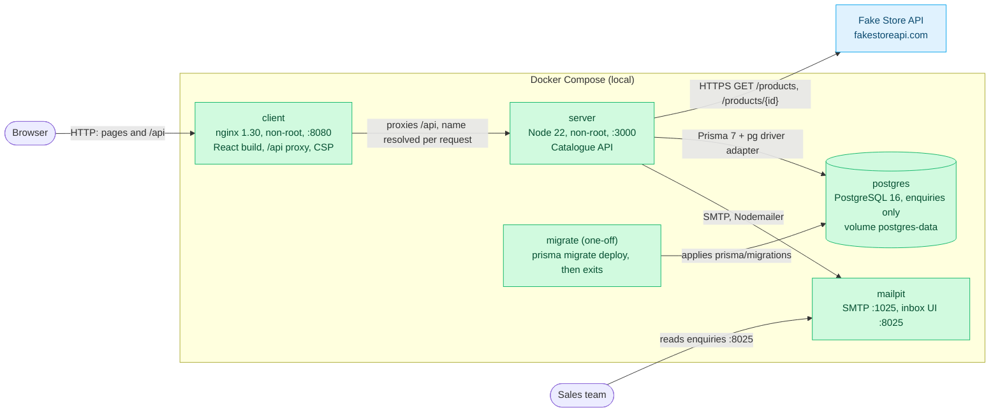
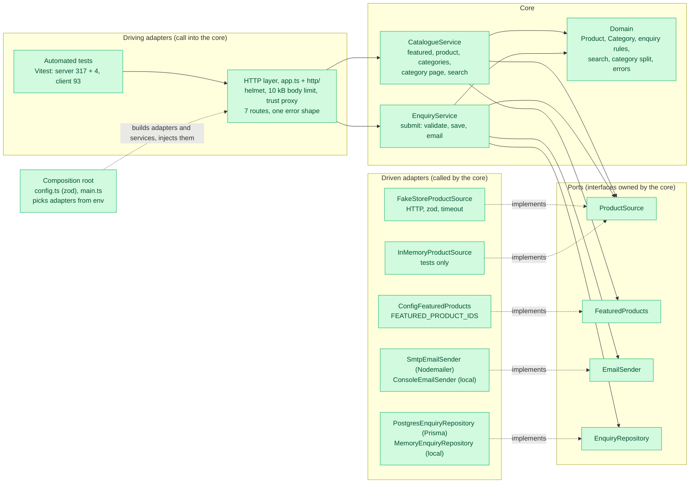
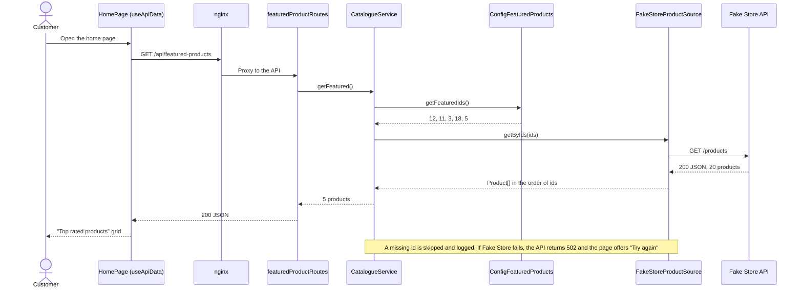
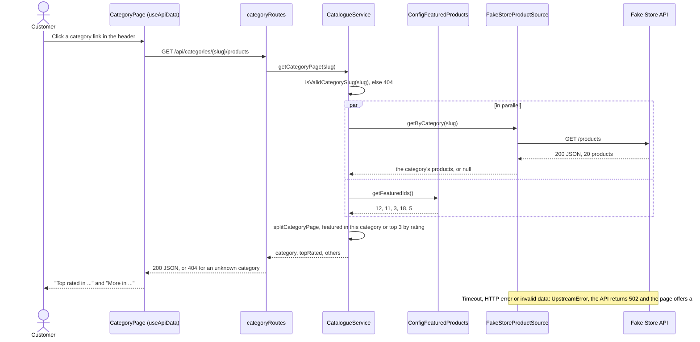
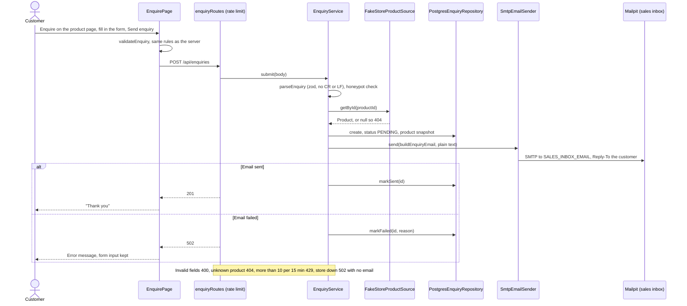

# High-level design (HLD)

**Status as of 2026-11-25:** all five acceptance criteria are built and tested. All seven slices are merged into `feature/product-catalogue-poc` (PRs #1 to #7). Generated from the code with `roadmap/HLD_PROMPT.md`.

**Architecture style:** ports and adapters (hexagonal). The business rules sit in a core that depends only on interfaces (ports). Every outside system (Fake Store, the email provider, the database, and the HTTP layer itself) is an adapter that can be replaced without changing the core. Adapters are chosen in one place, the composition root (`server/src/main.ts`), from configuration.

**Legend** (all diagrams): green = built and tested · blue = external system.

## 1. System context

Who uses the system and which outside systems it depends on.

## 2. Containers

What runs where. Locally everything runs in Docker Compose (`docker-compose.yml`); section 6 shows the AWS equivalents.

Start order: `postgres` (healthy) -> `migrate` (completed) -> `server` (healthy; also waits for `mailpit`) -> `client`. No `.env` is needed.

Rules shown here:

- The browser never calls Fake Store; all product data goes through the API (brief constraint). It only calls `/api` on its own origin, so there is no CORS.
- Products are never copied, into the database or a local file. The database holds enquiries only.
- The running API container has no Prisma CLI and cannot change the schema; only the one-off `migrate` container can.

## 3. API components (ports and adapters)

Inside the Catalogue API. Solid arrows are dependencies and point towards the core; dotted arrows mean "implements".

How `main.ts` wires each port:

| Port | Adapter at runtime | Chosen by | Other adapters |
|---|---|---|---|
| `ProductSource` | `FakeStoreProductSource` | always (single source of truth) | `InMemoryProductSource` (tests only) |
| `FeaturedProducts` | `ConfigFeaturedProducts` | `FEATURED_PRODUCT_IDS` (exactly 5 unique ids) | |
| `EnquiryRepository` | `PostgresEnquiryRepository` (Compose) | `ENQUIRY_STORE=postgres` + `DATABASE_URL` | `MemoryEnquiryRepository` (`memory`, the local default; refused in production) |
| `EmailSender` | `SmtpEmailSender` (Compose: to Mailpit) | `EMAIL_PROVIDER=smtp` + `SMTP_*` | `ConsoleEmailSender` (`console`, the local default; refused in production) |

Where each part lives:

| Element | Code |
|---|---|
| Domain: product and id rule, category and slug rule, category page split, search, enquiry validation, the enquiry email, errors | `server/src/domain/` (`product.ts`, `category.ts`, `category-page.ts`, `search.ts`, `catalogue-queries.ts`, `enquiry.ts`, `enquiry-email.ts`, `errors.ts`) |
| Ports | `server/src/ports/` (`product-source.ts`, `featured-products.ts`, `email-sender.ts`, `enquiry-repository.ts`) |
| Services | `server/src/services/` (`catalogue-service.ts`, `enquiry-service.ts`) |
| Adapters | `server/src/adapters/` (`fakestore/`, `in-memory/`, `featured-config/`, `email-smtp/`, `email-console/`, `enquiry-postgres/`, `enquiry-memory/`) |
| Contract suite every `ProductSource` must pass | `server/src/adapters/product-source.contract.ts` |
| HTTP app, routes, error handling | `server/src/app.ts`, `server/src/http/` (`errors.ts`, `routes/`) |
| Configuration and composition root | `server/src/config.ts`, `server/src/main.ts` |
| Database schema and migrations; generated client (git-ignored) | `server/prisma/`, `server/prisma.config.ts`; `server/src/generated/prisma/` |
| Web app: routes, the only API client, pages, shared components, theme tokens | `client/src/` (`routes.tsx`, `api/`, `pages/`, `components/`, `theme/tokens.css`) |
| Images and local run | `server/Dockerfile`, `client/Dockerfile`, `client/nginx/`, `docker-compose.yml` |

Web app routes: `/` (home), `/products/:id`, `/products/:id/enquire`, `/categories/:slug`, `/search?q=`, `*` (not found). Every page loads data through `useApiData` and shows the shared loading, error (with "Try again" where a retry can help) and empty states.

## 4. Key flows

### Home page (F1)

### Product page (F4) and search (F3)

Both follow the home page path:

- **Product page:** `GET /api/products/{id}` -> `CatalogueService.getProduct` -> `FakeStoreProductSource.getById` -> `GET /products/{id}`. An impossible id (outside `[A-Za-z0-9_-]{1,64}`) is a 404 before any upstream call; Fake Store's empty 200 for an unknown id is also a 404, shown as "Product not found".
- **Search:** `GET /api/search?q=term` -> `searchRoutes` validates `q` with zod (400 if missing, blank, repeated or over 100 characters, before any upstream call) -> `CatalogueService.search` -> `FakeStoreProductSource.search` filters `GET /products` with `matchesSearch` (every word, any order, in title, description or category name; plain substring, never a regex) -> the page shows the count and the tiles, or "No products match".

### Category page (F2)

The header's category links (`CategoryNav`) load `GET /api/categories` once when the app opens; `CatalogueService.getCategories` derives them from `GET /products`. If that fails, the header shows no links rather than a second error.

### Enquiry (F5)

Further rules of the flow: a filled honeypot gets 201 but nothing is saved or sent; the product title and price come from the product source, never the client; if the email was sent but marking it `SENT` fails, the customer still gets 201 (a retry would send a duplicate); logs carry the enquiry id and status only.

## 5. API surface

Every route as registered in `server/src/http/routes/`:

| Method and path | AC | Responses |
|---|---|---|
| `GET /api/health` | - | 200 `{ "status": "ok" }`; does not call Fake Store, the database or the mail server |
| `GET /api/featured-products` | F1 | 200 `Product[]` in configured order; 502 |
| `GET /api/products/{id}` | F4 | 200 `Product`; 404 `PRODUCT_NOT_FOUND` (unknown or impossible id); 502 |
| `GET /api/categories` | F2 | 200 `{ slug, name }[]`; 502 |
| `GET /api/categories/{slug}/products` | F2 | 200 `{ category, topRated, others }`; 404 `CATEGORY_NOT_FOUND` (unknown or impossible slug); 502 |
| `GET /api/search?q=` | F3 | 200 `Product[]` (empty when nothing matches); 400 `INVALID_SEARCH_TERM` with `details.field`; 502 |
| `POST /api/enquiries` | F5 | 201 `{ "status": "received" }` (also for a filled honeypot); 400 `VALIDATION_FAILED` with `details.fields`; 404 `PRODUCT_NOT_FOUND`; 429 `TOO_MANY_REQUESTS` with `Retry-After`; 502 |

`Product` is the API's own model: `{ id, title, description, price, imageUrl, category: { slug, name }, rating: { rate, count } | null }`; the Fake Store shape never leaves its adapter.

Errors always use one shape: `{ "error": { "code", "message", "details"? } }`. Any failure of an outside system (Fake Store, the database, the email provider), including timeouts, is 502 `UPSTREAM_UNAVAILABLE` with a generic message; malformed JSON 400 `INVALID_JSON`; a body over 10 kB 413; unknown routes 404 `NOT_FOUND`; anything unexpected 500. Stack traces and upstream messages are logged on the server, never sent.

## 6. Deployment

| Part | Local (Docker Compose, built) | AWS (target, not built: no infrastructure code in the repo) |
|---|---|---|
| Web app | `client` image: nginx, non-root, :8080, healthcheck | The same image on ECS Fargate with `API_UPSTREAM` and `NGINX_RESOLVER=169.254.169.253`, or the static build on S3 + CloudFront |
| Catalogue API | `server` image: Node 22, non-root, production dependencies only (no Prisma CLI), healthcheck, graceful SIGTERM | ECS Fargate behind an Application Load Balancer |
| Enquiry database | `postgres:16-alpine`, volume `postgres-data` (kept across `down`/`up`; `down -v` deletes it) | Amazon RDS for PostgreSQL with automated backups |
| Migrations | `migrate`: the server image's build stage, `prisma migrate deploy`, runs once before the API | The same command as a one-off ECS task in the release pipeline |
| Email | `mailpit` (catches all mail; inbox at :8025) | Amazon SES over SMTP: a configuration change (`SMTP_HOST`, `SMTP_PORT`, `SMTP_SECURE`, `SMTP_USER`, `SMTP_PASS`, a verified `EMAIL_FROM` domain) |
| Configuration | Defaults in code and in `docker-compose.yml`; optional `.env` | Systems Manager Parameter Store; `DATABASE_URL` and SMTP credentials in Secrets Manager |
| Product data | Fake Store API | Fake Store API; later a PIM or an owned product service behind `ProductSource` |

## 7. Cross-cutting concerns

| Concern | Approach |
|---|---|
| Validation | zod on every upstream response, every config value and every request input (search query, enquiry body); product ids and category slugs checked by domain rules before any upstream call; the web app checks the enquiry form with the same rules for instant feedback, and the server's answer wins |
| Errors | `UpstreamError` and `ConfigError` in the core, `ApiError` in the HTTP layer, all rendered by `errorHandler` in one shape; retry is offered only where it can help (502, network), not for 400 or 404 |
| Configuration | Parsed and validated once at startup; one `ConfigError` lists every bad key (exit code 1); defaults in code equal `.env.example` (a test checks); production refuses the local-only enquiry store and email |
| Security | helmet headers, `x-powered-by` off, 10 kB JSON limit; nginx CSP, nosniff, `X-Frame-Options: DENY`; no control characters (CR/LF) in single-line enquiry fields and a plain-text email (no header or HTML injection); product details for the email come from the source; rate limit (10 per client per 15 min, client address from the trusted proxy only) and honeypot on enquiries; http(s)-only image URLs; no regex built from input; non-root containers; no secrets committed or in images; no personal data in logs |
| Persistence | Enquiries only, in PostgreSQL: `PENDING` before the email, then `SENT` or `FAILED` with the reason; each row keeps a snapshot of the product's id, title and price (`decimal(10,2)`), with no copy of the catalogue |
| Resilience | Fake Store calls time out (5 s) and fail as 502 with a retry on the page; SMTP times out (5 s connect, 10 s socket); a failed email keeps the enquiry as `FAILED`; nginx re-resolves the API's address every 10 s, so recreating the API container does not break the proxy |
| Testing | Server (317, plus 4 against a real PostgreSQL when `TEST_DATABASE_URL` is set): unit tests per module, a contract suite for every `ProductSource`, Supertest for every route, a recorded Fake Store response behind a fake `fetch`, an in-memory store and a recording email sender. Client (93): Vitest, Testing Library and MSW, where a request without a handler fails the test. Each AC has a test that does what a user does. No default test uses the network or a database. Mutation checks in every slice confirmed the tests fail when the behaviour breaks |
| Swappability | Product source, email provider and enquiry store each sit behind a port and are chosen in `main.ts`; look and feel is in `client/src/theme/tokens.css` only |

## 8. Status by slice

| Slice | Branch | Delivers | Status |
|---|---|---|---|
| 00 | `setup/data-layer` | Domain, `ProductSource` and `FeaturedProducts` ports, Fake Store adapter, contract suite | Merged (PR #1) |
| 01 | `setup/foundation` | Config, composition root, HTTP skeleton, web app skeleton, both images, Docker Compose | Merged (PR #2) |
| F1 | `slice/feature-home` | Home page, 5 top-rated products | Merged (PR #3) |
| F4 | `slice/feature-product` | Product page | Merged (PR #4) |
| F2 | `slice/feature-category` | Category links and page | Merged (PR #5) |
| F3 | `slice/feature-search` | Search | Merged (PR #6) |
| F5 | `slice/feature-enquiry` | Enquiry form, email, PostgreSQL + Prisma, Mailpit, migrate service | Merged (PR #7) |

The reasons behind these design choices, and the trade-offs, are in `DECISIONS.md`.
